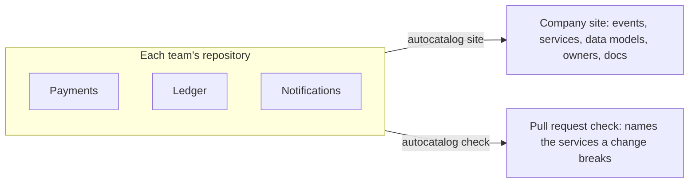

# autocatalog

A catalog of your events, services and docs, with nothing to set up.

Run one command in a repository that has schemas and Markdown:

```bash
npx autocatalog site . --dev
```

You get a site with a page for each event and each service, and your docs beside
them. You write no config, no catalog entries and no service definitions, and
your repository stays exactly as it was. Add one step to CI and a pull request
that breaks another team fails, naming the service it breaks.

**[Documentation](https://jagreehal.github.io/autocatalog)**

## The setup you skip

We started from two files: one JSON Schema and one Markdown page.

| What you do                    |                                     |
| ------------------------------ | ----------------------------------- |
| Commands to run                | 1                                   |
| Config files to write          | 0                                   |
| Packages to install            | 0, `npx` runs it                    |
| Files added to your repository | 0                                   |
| Pages you get                  | 24, built in 13 seconds on a laptop |
| Service pages you wrote        | 0 of 2                              |

Your first `npx` run also downloads the package, which took us under two minutes.

The rest of a catalog's usual upkeep goes the same way:

| The job               | The usual way                                     | With autocatalog                                     |
| --------------------- | ------------------------------------------------- | ---------------------------------------------------- |
| Describe a service    | Write and maintain an entry for it                | It comes from the events that name it                |
| Add a repository      | Edit a central list                               | Add a GitHub topic                                   |
| Keep the catalog true | Remember to update it in each pull request        | It rebuilds from your contracts on every run         |
| Name owners           | Keep a list somewhere                             | It reads CODEOWNERS, or one line in `docs/meta.json` |
| Check pull requests   | Write a workflow, install, fetch, script the gate | Add one action                                       |
| Host it               | Run a server and a database                       | Upload a static folder to any host                   |
| Brand it              | Fork a theme                                      | Drop your logo and colours in a folder               |

Each team keeps its contracts with its code, as Zod, Pydantic, JSON Schema,
OpenAPI, AsyncAPI, Avro or protobuf. autocatalog joins those repositories into
one view:



## Catch the break before it ships

A producer renames `amount` to `amountMinor`. The pull request still compiles
and its tests still pass. Two services downstream start reading `undefined`.

`autocatalog drift` discovers the contracts on `main` and on your branch,
compares them, and names the consumers each incompatible change affects:

```text
breaking   payments/payment.completed: field `amount` (number) looks renamed to `amountMinor`
           → breaks LedgerService, NotificationService.
           Next: keep `amount` alongside `amountMinor` until consumers move off it,
           or bump to 2.0.0 to mark it intentional and notify LedgerService, NotificationService
suspicious payments/payment.completed: schema changed but version stayed at 1.0.0

1 breaking · 1 suspicious · 0 additive
```

This is the whole workflow. It checks your documents, contracts and events, and
compares them with the base branch:

```yaml
name: catalog
on: pull_request
jobs:
  check:
    runs-on: ubuntu-latest
    steps:
      - uses: jagreehal/autocatalog/actions/check@v1
```

The action finds what your repository publishes and skips the rest. Document
and contract failures mark the files they name. On another CI, run
`npx autocatalog check --base-ref origin/main`.

A team in another repository declares what it reads in its own
`autocatalog.consumes.json`. Pass the company site's index with
`--consumers https://catalog.acme.dev/catalog.json` and drift names that team
too, even though the producer never listed it.

The gate covers removed and renamed fields, type changes, fields that become
required, narrowed enums and changed delivery guarantees. `--compatibility
backward` gates on Schema Registry rules instead. The
[drift guide](docs/drift-ci.md) lists each rule and its severity.

## Keep teams out of each other's databases

`autocatalog drift` guards team boundaries in the same run. It sees which
tables and collections each service reads and writes, from Mongoose, Prisma and
Drizzle models in code or from traces, and takes owners from CODEOWNERS and
`catalog-info.yaml`. A pull request that has one team's service read another
team's data fails:

```text
checkout (payments) reads collection acme/finance/statements, which ledger owns
```

Only new cross-team access fails. Access that already exists stays quiet, so
you can turn the rule on in an existing codebase without first untangling old
dependencies. To allow a deliberate exception, such as a migration, declare it
with `autocatalog resources promote`; it then shows as a warning.

## One site for the whole company

Teams own their contracts in their own repositories, and the organisation still
gets one view. One command builds a site across all of them:

```bash
npx autocatalog site --topic catalog --owner acme
```

A team joins by adding the `catalog` topic to its GitHub repository, and nobody
edits a list or approves anything. The site gives you:

- a page per event with its schema, examples, version history and the file that
  defines it
- a page per service and per domain, with a map of what it produces and
  consumes and the services on the other side
- a catalog map of every service, event, command and datastore
- an API reference for each OpenAPI spec under `contracts/`
- a schema index, and a field index so you can see which events carry
  `customerId` before you change it
- owner pages, with the team's contact and everything it owns
- your teams' Markdown docs, with Mermaid diagrams, owner and last-changed date
  on each page

Search, navigation and dark mode come from
[Starlight](https://starlight.astro.build).

### Make it yours

One file and one folder turn it into your company's site, and neither runs code:

```json
{
  "title": "Acme Docs",
  "topic": "catalog",
  "owner": "acme",
  "brand": "./brand",
  "theme": "teal"
}
```

Save that as `autocatalog.site.json` and `npx autocatalog site` needs no flags.
`brand/` holds your logo, favicon and `theme.css`, and readers see your name on
every page. Five accent themes ship built in, and custom themes cost nothing.

A team names its own section with `docs/meta.json`: a label, a description, an
owner for every page, and the order of its folders. Diagrams with `%% narrate`
lines play step by step and read themselves aloud.

To deploy, the `actions/site` action builds the site, skips the build when no
repository changed, and hands you a folder for any host.

## Define an event once

With Zod, `defineEvent` adds catalog metadata and returns the schema unchanged,
so `z.infer` and `.parse()` keep working:

```ts
import { defineEvent } from 'autocatalog-plugin-zod';
import { z } from 'zod';

export const PaymentCompleted = defineEvent(
  {
    domain: 'payments',
    team: 'Billing',
    producers: ['PaymentService'],
    consumers: ['LedgerService', 'NotificationService'],
  },
  z.object({ id: z.string(), amount: z.number() }),
);
```

`npx autocatalog scan . --allow-code-execution` writes
`events/payments/PaymentCompleted/` with `schema.json`, examples and metadata.
The Zod plugin reads your TypeScript source and does not import your modules.
`scan` asks for `--allow-code-execution` because it runs the plugin package
installed in your repository's `node_modules`. Your own modules do not run.

Commit `events/`, and the site and MCP server read it from there. Re-run the
scan when a contract changes.

You don't write service definitions. autocatalog builds `PaymentService` from
the events that name it.

Producers and consumers come from what you declare beside the schema: in
`defineEvent`, in a Pydantic model's config, or under `x-autocatalog` in a
schema file. An AsyncAPI or EventCatalog import brings its own. Traces then
flag any event a service emits that the catalog doesn't list.

Python teams get the same result from Pydantic with `autocatalog-py extract`.
Teams with JSON Schema, OpenAPI, Avro or protobuf files run `autocatalog scan`
and change nothing in their code.

## Give coding agents the architecture

The site, the pull request check and your coding agent all read one model of
your architecture, built from the code. `autocatalog-mcp` gives AI coding agents
14 tools over that model. An agent can look up an event's schema and examples,
find which events carry a field, check whether a change breaks a consumer
before it writes the code, look up what a word means in the domain, and draw
the catalog, a flow or a new design as a diagram in Claude or ChatGPT.

```json
{
  "mcpServers": {
    "autocatalog": {
      "command": "npx",
      "args": ["autocatalog-mcp", "--root", "."]
    }
  }
}
```

The site also publishes `llms.txt`, a Markdown copy of each page, and
`contracts/docs-manifest.json` for `ac docs check --manifest`.

## Works with EventCatalog

[EventCatalog](https://www.eventcatalog.dev) draws interactive architecture
diagrams. autocatalog works with it three ways:

- **Diagrams in your site.** `autocatalog site --eventcatalog` builds
  EventCatalog 4 alongside the site and shows its diagrams on event pages,
  service pages and an Architecture page.
- **Keep your portal.** `autocatalog to-eventcatalog ./catalog` writes your
  events, commands, services, datastores, owners and systems into an
  EventCatalog project, so your team keeps reading EventCatalog while
  autocatalog checks the pull requests. The same export runs as an
  EventCatalog generator that scans your repositories.
- **Move in.** `autocatalog from-eventcatalog ./catalog` imports an existing
  EventCatalog project. Export it and import it again, and you get the same
  files back.

## Already have AsyncAPI

`autocatalog from-asyncapi spec.yaml` imports an AsyncAPI 2.x or 3.x document.
`autocatalog to-asyncapi` writes a service's view as AsyncAPI 3.0 for mock
servers and code generators.

## Commands

| Command                                    | Use it to                                              |
| ------------------------------------------ | ------------------------------------------------------ |
| `autocatalog site . --dev`                 | preview this repository's site                         |
| `autocatalog check --base-ref origin/main` | run everything a pull request needs                    |
| `autocatalog scan .`                       | build `events/` from the schemas in the repository     |
| `autocatalog drift --base-ref origin/main` | fail a pull request that breaks a consumer             |
| `autocatalog validate`                     | check the committed catalog                            |
| `autocatalog fields customerId`            | find the events that carry a field, and who reads them |
| `autocatalog health`                       | score events on ownership, examples and versioning     |
| `autocatalog docs check`                   | check docs frontmatter and links across repositories   |
| `autocatalog site --topic catalog`         | build the site across enrolled repositories            |

`ac` is a short alias once `autocatalog-cli` is installed.

## Packages

| Package                         | What it does                                               |
| ------------------------------- | ---------------------------------------------------------- |
| `autocatalog`                   | the one to install: `npx autocatalog`                      |
| `autocatalog-cli`               | the `ac` command                                           |
| `autocatalog-core`              | catalog model, scanners, drift rules                       |
| `autocatalog-plugin-zod`        | `defineEvent` for Zod                                      |
| `autocatalog-plugin-storybook`  | `ac from-storybook`: Storybook components on the site      |
| `autocatalog-plugin-kong`       | `ac from-kong`: what a Kong gateway exposes, on the site   |
| `autocatalog-plugin-kubernetes` | `ac from-kubernetes`: calls checked against network policy |
| `autocatalog-mcp`               | MCP server for AI coding agents                            |
| `autocatalog-docs-astro`        | the Starlight site                                         |
| `autocatalog-docs-core`         | docs aggregation and the frontmatter contract              |
| `autocatalog-agents-*`          | a catalog for AI agents, their tools and policies          |
| `autocatalog-py`                | the Pydantic extractor                                     |

## Contributing

```bash
pnpm install
pnpm release:check   # lint, build, type-check, tests and smoke checks
```

A change to a published package needs a changeset: `pnpm changeset`.

## License

MIT
