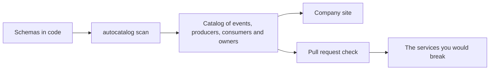

# autocatalog

Know who depends on your event contracts before you break them.

Your contracts already live in code, as Zod, Pydantic, JSON Schema, OpenAPI,
AsyncAPI, Avro or protobuf. autocatalog finds them, works out which services
produce and consume each one, and fails a pull request before a breaking change
reaches another team.



Preview the site for one repository with schemas in `contracts/` and Markdown
in `docs/`:

```bash
npx autocatalog site . --dev
```

You get a searchable site of your events, services, owners and docs, with no
configuration. Previewing writes nothing to your repository.

Check a pull request in CI:

```bash
npx autocatalog drift --base-ref origin/main --root .
```

autocatalog builds the catalog from `main` and from your branch, compares them,
and names the consumers each incompatible change affects.

**[Documentation](https://jagreehal.github.io/autocatalog)**

## Catch the break before it ships

A producer renames `amount` to `amountMinor`. The pull request still compiles
and its tests still pass. Two services downstream start reading `undefined`.

`autocatalog drift` compares the catalog built from `main` with the one built
from the pull request, and names who you break:

```text
breaking   payments/payment.completed: field `amount` (number) looks renamed to `amountMinor`
           → breaks LedgerService, NotificationService.
           Next: keep `amount` alongside `amountMinor` until consumers move off it,
           or bump to 2.0.0 to mark it intentional and notify LedgerService, NotificationService
suspicious payments/payment.completed: schema changed but version stayed at 1.0.0

1 breaking · 1 suspicious · 0 additive
```

Add it to CI and the pull request fails with that message:

```yaml
- run: git fetch origin main
- run: npx autocatalog drift --base-ref origin/main --root . --format github
```

The gate covers removed and renamed fields, type changes, fields that become
required, narrowed enums and changed delivery guarantees. `--compatibility
backward` gates on Schema Registry rules instead. The
[drift guide](docs/drift-ci.md) lists each rule and its severity.

## Keep teams out of each other's databases

The same check guards team boundaries. autocatalog sees which tables and
collections each service reads and writes, from Mongoose, Prisma and Drizzle
models in code or from traces. It takes owners from CODEOWNERS and
`catalog-info.yaml`. A pull request that has one team's service read another
team's data fails:

```text
checkout (payments) reads collection acme/finance/statements, which ledger owns
```

Access that already exists stays quiet, so you can turn this on in a large
codebase today. `autocatalog resources promote` records a deliberate exception,
such as a migration.

## One site for the whole company

Each team keeps its contracts and docs in its own repository. One command builds
a site across all of them:

```bash
npx autocatalog site --topic catalog --owner acme
```

A team joins by adding the `catalog` topic to its GitHub repository. The site
gives you:

- a page per event with its schema, examples, version history and the file that
  defines it
- a page per service listing what it produces and consumes, and who owns it
- a field index, so you can see which events carry `customerId` before you
  change it
- owner pages, with the team's contact and everything it owns
- your teams' Markdown docs, with owner and last-changed date on each page

Search, navigation and dark mode come from
[Starlight](https://starlight.astro.build).

## Define an event once

With Zod, `defineEvent` adds catalog metadata and returns the schema unchanged,
so `z.infer` and `.parse()` keep working:

```ts
import { defineEvent } from 'autocatalog-adapter-zod';
import { z } from 'zod';

export const PaymentCompleted = defineEvent(
  {
    domain: 'payments',
    team: 'Billing',
    producers: ['PaymentService'],
    consumers: ['LedgerService', 'NotificationService'],
  },
  z.object({ id: z.string(), amount: z.number() }),
);
```

`npx autocatalog . --allow-code-execution` runs your code to read the Zod
schemas, and writes `events/payments/PaymentCompleted/` with `schema.json`,
examples and metadata. Commit `events/`, and the site and MCP server read it
from there. Re-run the scan when a contract changes.

You don't write service definitions. autocatalog builds `PaymentService` from
the events that name it.

Python teams get the same result from Pydantic with `autocatalog-py extract`.
Teams with JSON Schema, OpenAPI, Avro or protobuf files run `autocatalog scan`
and change nothing in their code.

## Ask the catalog from your editor

`autocatalog-mcp` gives AI coding agents 12 tools over the catalog. An agent can
look up an event's schema and examples, find which events carry a field, and
check whether a change breaks a consumer before it writes the code.

```json
{
  "mcpServers": {
    "autocatalog": {
      "command": "npx",
      "args": ["autocatalog-mcp", "--root", "."]
    }
  }
}
```

The site also publishes `llms.txt` and a Markdown copy of each page.

## Already have a catalog

- `autocatalog from-asyncapi spec.yaml` imports an AsyncAPI 2.x or 3.x document.
- `autocatalog from-eventcatalog ./catalog` imports an EventCatalog project:
  events, commands, services, datastores, owners and systems.
  `autocatalog to-eventcatalog` writes them back, so a team can keep its
  EventCatalog portal while autocatalog gates the pull requests.
- `autocatalog to-asyncapi` writes a service's view as AsyncAPI 3.0 for mock
  servers and code generators.

## Commands

| Command                                    | Use it to                                              |
| ------------------------------------------ | ------------------------------------------------------ |
| `autocatalog site . --dev`                 | preview this repository's site                         |
| `autocatalog scan .`                       | build `events/` from the schemas in the repository     |
| `autocatalog drift --base-ref origin/main` | fail a pull request that breaks a consumer             |
| `autocatalog validate`                     | check the committed catalog                            |
| `autocatalog fields customerId`            | find the events that carry a field, and who reads them |
| `autocatalog health`                       | score events on ownership, examples and versioning     |
| `autocatalog docs check`                   | check docs frontmatter and links across repositories   |
| `autocatalog site --topic catalog`         | build the site across enrolled repositories            |

`ac` is a short alias once `autocatalog-cli` is installed.

## Packages

| Package                   | What it does                                      |
| ------------------------- | ------------------------------------------------- |
| `autocatalog`             | the one to install: `npx autocatalog`             |
| `autocatalog-cli`         | the `ac` command                                  |
| `autocatalog-core`        | catalog model, scanners, drift rules              |
| `autocatalog-adapter-zod` | `defineEvent` for Zod                             |
| `autocatalog-mcp`         | MCP server for AI coding agents                   |
| `autocatalog-docs-astro`  | the Starlight site                                |
| `autocatalog-docs-core`   | docs aggregation and the frontmatter contract     |
| `autocatalog-agents-*`    | a catalog for AI agents, their tools and policies |
| `autocatalog-py`          | the Pydantic extractor                            |

## Contributing

```bash
pnpm install
pnpm release:check   # lint, build, type-check, tests and smoke checks
```

A change to a published package needs a changeset: `pnpm changeset`.

## License

MIT
