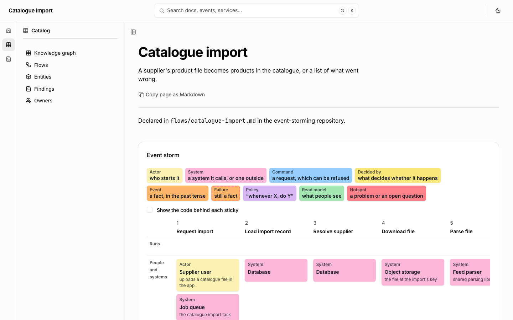
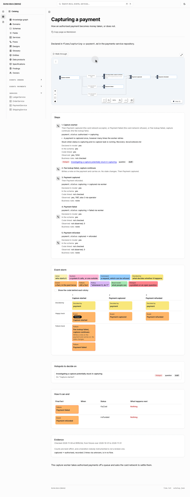

Most of what a company knows about how its system behaves sits in tickets and in
people's heads. Autocatalog gives that knowledge a home in the repository, and
compares it with the code and with what ran. Your system does not need to be
event-driven: a status written to a database is enough to start.

Three things stay separate:

| Term                  | Means                                    | Example                  |
| --------------------- | ---------------------------------------- | ------------------------ |
| Business event        | Something meaningful happened            | Capture started          |
| Expected transition   | The model says this change should happen | `authorised → capturing` |
| Observed state change | A system recorded this change            | a persisted status write |

A status can be wrong. It can say `capturing` after the work has died, so a recorded
change shows what was written, not what happened.

## After an investigation

Write what you learned as a finding, in `docs/findings/`:

```markdown
---
title: Investigating a capture potentially stuck in capturing
owner: Payments
ticket: SUP-1042
entity: payment
nature: question
status: draft
date: 2026-11-06
flow: capturing-a-payment
step: started
---

## What was seen

## What was happening

## How to spot it

## How to recover
```

`nature` is `behaviour`, `defect` or `question`. `status` is the state of the
knowledge: `draft`, `confirmed` or `superseded`. A defect's own workflow stays in
your tracker. Add `resolved` with the fix or the answer, and the map stops warning.

Keep the ticket id and the system's behaviour. Leave out customer names, emails, bank
details, real transaction values and pasted records, because a finding reaches the
site, `llms.txt` and MCP. Synthetic amounts and business thresholds are fine.

Any kind of document can attach to a flow with `flow:` and `step:`, including kinds
you define in [the conventions file](/docs/docs-convention#the-conventions-file). A
`flow:` is a flow's id, or `<repository>/<id>` for one another repository keeps.

## Model the states

An entity names the states each field moves through. One entity can have several
lifecycles, so they are keyed by field:

```yaml
---
name: Payment
lifecycles:
  status:
    states: [authorised, capturing, captured, failed]
    initial: authorised
    terminal: [failed]
---
```

A flow names what its steps change. A step can override `entity` and `field`:

```yaml
---
title: Capturing a payment
entity: payment
field: status
steps:
  - id: started
    title: Capture started
    transition: { from: authorised, to: capturing }
    code:
      - { file: src/capture.js, contains: "status: 'capturing'" }
    rules:
      - A payment is captured once
      - { text: Retries are safe, test: test/capture.test.js }
    stuck:
      signs: status is capturing and no capture task is running
      recovery: docs/runbook.md
    next_steps:
      - { id: captured, label: the network accepts }
      - { id: lookup-failed, label: the fee lookup fails }
  - id: lookup-failed
    title: Fee lookup failed, capture continues
    next_step: captured
  - id: captured
    title: Payment captured
    transition: { from: capturing, to: captured, via: worker }
---
```

`from` takes one state or a list. A step needs no transition, because a failure can
change nothing the lifecycle tracks. `stuck` is prose: nothing times it.

Two steps can share a transition and mean different things. If an operator can set
`captured` to release a payment, that is its own flow with its own entry point, and
`via` tells the two apart. `ac docs check` fails a transition using a state the
lifecycle lacks, and warns about a non-initial state no flow reaches.

## Storm a process

A flow page draws an EventStorming board: a column per stage, read left to right,
with rows for who takes part, the command, what decides, the facts on the happy
and failure tracks, and the policies under them.



Every flow also draws as a map of its steps and branches. **Walk through**, above
the map, steps through it one hop at a time, choosing a branch where the flow
splits:


Write the board in the flow's
frontmatter, beside the code it describes:

```yaml
---
title: Catalogue import
entity: import
field: status
steps:
  - id: download
    stage: Download file
    title: Catalogue file downloaded
    command: Download catalogue file
    systems:
      - { name: Object storage, summary: the file at the import's key }
    decidedBy: Import
    code: [{ file: src/import.ts, contains: downloadFile }]
    next_steps:
      - parse
      - { id: file-missing, label: nothing at that key }
  - id: file-missing
    title: Catalogue file missing
    policy: Whenever the file can't be fetched, fail the import
    next_step: errored
  - id: ingest
    stage: Ingest each product
    title: Product created or updated
    repeats: once per parsed product
    flow: ingest-product
scenarios:
  - given: No file at the import's key
    when: The import runs
    then: The status is errored and the user is told
    step: errored
---
```

| Field                             | On the board                                                  |
| --------------------------------- | ------------------------------------------------------------- |
| `stage`                           | The column. Steps that share a stage stack in one column      |
| `command`                         | The request, or `{ ref: <domain>/<id> }` for a catalog one    |
| `actors`, `systems`, `readModels` | Who takes part, and what people see                           |
| `decidedBy`                       | What decides; a step with a transition defaults to its entity |
| `policy`                          | "Whenever X, do Y": one, or a list                            |
| `track`                           | `happy` or `failure`, over what the board works out           |
| `repeats`, `flow`                 | A stage that loops, and the flow that zooms into it           |
| `scenarios` (on the flow)         | Given, When, Then, with `expected` where today differs        |

The happy track follows the first branch out of each step from the start, and
every other step is a failure. A failure is still a fact. One with no policy, no
next step and no status change is a hotspot: the board shows it in the policy
row, and `ac docs check` warns. A finding on a step with `nature: question` or
`defect` tags its sticky and joins the hotspots below the board, beside how each
run can end and the scenarios to test. These checks apply to a flow that uses
any field above; an older flow's branches may be alternatives, so it draws a
board and raises nothing.

`/flows/` lines every flow up as a lane of facts, the big picture, with how many
ways each can fail and how many hotspots are open. `flow_context` gives an agent
each step's track, stage and policies, with the hotspots, endings and scenarios.

### Draft a board from Effect code

`ac flows draft` reads an [Effect](https://effect.website) v4 program with
[effect-analyzer](https://github.com/jagreehal/effect-analyzer) and prints a
flow: a stage per call, a failure per error the call can fail with, and the
services it needs as systems. What follows a failure depends on the handler that
catches it. A handler on the call that can succeed carries on to the next step;
one that fails with another error leads to that failure, which joins the board
unless a handler after it on the same call recovers;
a handler around the whole program stops the run. An error nothing catches has
no policy, so it lands on the board as a hotspot to decide, and so does one
caught by a handler the draft cannot read. A program that makes the same call
twice gets two steps, and when the last call can fail, the run's success is an
ending of its own.

```bash
npm install -D effect-analyzer
ac flows draft src/import.ts --program runImport --id catalogue-import --write
```

Rename each fact in the business's words, add the policies the team agrees, and
commit it. `ac flows verify` then checks each step's `code:` is still there.

### Boards in MDX

Three components work in any `.mdx` document without an import:

```mdx
Every run starts with <Sticky kind="event">Import loaded</Sticky>.

<Storm flow="catalogue-import" show={['hotspots', 'endings']} />

<Storm
  label="Catalogue export"
  stages={[
    { stage: 'Request export', actor: 'Supplier user', command: 'Export catalogue' },
    {
      stage: 'Write file',
      event: 'Catalogue file written',
      failure: { text: 'Export too large', hotspot: true },
      hotspot: 'What is too large?',
    },
  ]}
/>
```

`<Storm flow>` draws a flow's board, by id or `<repository>/<id>`. `<Storm
stages>` draws one you sketch by hand before there is code: each stage takes
`actor`, `system`, `readModel`, `command`, `decidedBy`, `event`, `failure`,
`policy` and `hotspot`, each a sticky or a list. `<Sticky kind>` puts one in a
sentence. On a page of your own, import the React parts from
`autocatalog-docs-astro/ui/components`: `StormBoard`, `Sticky`, `StormLegend`,
`StormHotspots`, `StormEndings`, `StormScenarios` and `BigPicture`.

## What verified means

There is no overall status, because each kind of evidence proves something different:

| Evidence         | Establishes                     | Does not establish                    |
| ---------------- | ------------------------------- | ------------------------------------- |
| Schema           | A state is defined              | That anything can reach it            |
| Code link        | The linked code is there        | That the transition succeeds          |
| Production count | A transition was recorded       | That it happened for the right reason |
| Linked test      | It worked under test conditions | That production always behaves so     |

```bash
ac flows verify --observed transitions.json --write
```

This writes `flows/evidence.json`, with the commit checked and the observation window,
and the flow's page shows each dimension. Evidence over 30 days old reads as old.

- `not observed` means it was instrumented and nothing was recorded in the window.
- `not instrumented` means nothing was watching. Both describe coverage, so read them as gaps in evidence.
- A rule in prose stays `not checked`. A rule with a test reads `test linked`.
- A step with a `via` counts only that `via`. Database-only observation reports
  `unknown`, so it is shown beside the step and never credited to it.
- Anything recorded that no flow declares is listed.
- A step edited since the check reads `not checked` until you run it again, because
  the old results were about a different claim.

The command exits 1 only when a claim is contradicted: a state outside the lifecycle or
schema, or code that is gone.

## Runtime evidence through MCP

[autotel](https://github.com/jagreehal/autotel)'s `transition()` counts persisted
transitions, without depending on trace sampling. Its MCP server reads them back with
`get_state_transitions`, which returns the file `--observed` takes. Counts are
best-effort evidence, not an authoritative number.

To investigate, an agent asks `flow_context` for the flow, then reads each transition
with the `observe` hints it returns. That is exploration: the agent explains the
record, and `ac flows verify` decides what counts as a match. Draft findings and
questions come with their status, so an agent can tell a hypothesis from a fact.
