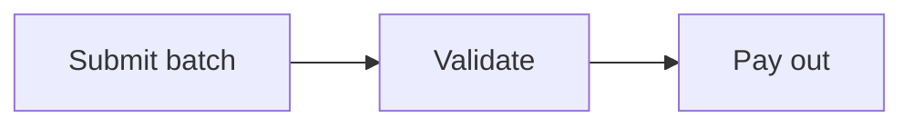

`ac site` builds one Starlight site from the repositories you enrol. Documents,
events, services and fields share one index, with Starlight's search, navigation
and dark mode.

## Build it

```bash
npx autocatalog site --topic catalog --owner acme \
  --site https://acme.github.io --base /catalog/
```

The command lists every repository `acme` owns with the `catalog` topic, clones
each one with its history, and writes the site to `dist/`. A team enrols its
repository by adding the topic on GitHub. Nobody edits a list in the site's
repository, and the site's owners approve nothing.

| Flag                 | Meaning                                                                           |
| -------------------- | --------------------------------------------------------------------------------- |
| `--topic`, `--owner` | Clone every repository the owner has with the topic                               |
| `--repo <url...>`    | Clone these repositories as well                                                  |
| `[root]`             | Build from checkouts already on disk, or from one repository                      |
| `--site`, `--base`   | Where the site is served, for links, the sitemap and `llms.txt`                   |
| `--title`            | The site's title                                                                  |
| `--description`      | One sentence for the home page and `llms.txt`                                     |
| `--brand`            | A folder with your logo, favicon and theme                                        |
| `--theme`            | An accent colour by name                                                          |
| `--audience`         | Build for readers outside, e.g. `public`: see [Public API docs](#public-api-docs) |
| `--out`              | Output directory, `dist` by default                                               |
| `--dev`              | Serve with live reload                                                            |
| `--eventcatalog`     | Draw diagrams with EventCatalog, inside this site                                 |
| `--docs-schema`      | The docs frontmatter contract to enforce                                          |

Set the flags once in `package.json` and reuse them for the dev server:

```json
{
  "scripts": {
    "build": "autocatalog site --topic catalog --owner acme --site https://acme.github.io --base /catalog/",
    "dev": "npm run build -- --dev"
  }
}
```

The default favicon is the three provenance marks (declared, extracted,
inferred). `--brand` replaces it; see [Make it yours](#make-it-yours).

The command prints how many repositories it cloned and whether it had a token.
Private repositories need `GITHUB_TOKEN` or `GH_TOKEN`. The command sends the
token as a request header, over HTTPS to `github.com` or the host in
`GITHUB_SERVER_URL`, so it never lands in a clone's `.git/config`.

The command clones each repository once, even when you enrol it by topic and
by `--repo`. When a clone fails, it names the repository with git's message and
builds the site from the rest. It writes `--out` once the build completes, so a
failed build leaves your last site in place.

Run `npx autocatalog site .` inside one repository to preview what it publishes
before you enrol it.

Every document must satisfy the company's frontmatter contract, or the build
fails and names the document. The contract is `--docs-schema` when given, else
`contracts/docs-frontmatter.json` at the root, else the one an enrolled
repository publishes there, such as a handbook. Copies other repositories keep
with `ac docs sync-schema` are the same contract; two repositories publishing
different ones fail the build, naming both, until `--docs-schema` picks one.

A repository whose document breaks the contract is left out and the rest
publish. When that leaves no documents at all, the build fails, so a deploy
keeps the last good site.

## What each page shows

- `/` lists every document by repository, with its owner and last change.
- `/<repo>/<path>/` is one document: its owner, the date git last saw it change,
  a link to the file on its repository, and the documents on either side of its
  `related` edges.
- `/events/<repository>/<domain>/<id>/` is one event: where its contract was
  found, its schema as a tree, its examples, any narrative the team wrote beside
  it, and the services that produce and consume it. The repository and domain
  are in the address, so two repositories can publish the same event id.
  Earlier versions sit under it at `v/<version>/`, with what changed between
  each: a committed catalog's `versioned/` folders, or, for a repository that
  publishes only `contracts/`, each earlier version its contracts declared in
  the last 50 commits to `contracts/`, read from git without checking anything
  out. A contract that declares no version has no history.
  Without a committed `events/`, a repository's events are what `contracts/`
  holds (JSON Schema, OpenAPI, Avro, protobuf) plus any
  [autotel-message-contract](/docs/events/message-contracts) approved file,
  `__contracts__/*.approved.txt`, anywhere in it. Nothing else outside
  `contracts/` is read, and that walk skips `node_modules`, `dist` and
  dot-folders and reads only regular files.
- Runtime evidence: when a repository has `.autotel/snapshot.json`, where
  autotel's `ArchitectureSnapshotSubscriber` writes it, the site joins it onto
  that repository's current events, committed catalog or discovered contracts
  alike, so the event page shows what ran without committing `events/`, and
  contract history from git still works. Only a regular file inside the
  repository is read, never a symlink. A snapshot that does not read is a
  warning in the build, and the repository's events publish without evidence.
- `/services/<name>/` lists what one service produces and consumes. The pages
  come from each event's `producers` and `consumers`, so declaring
  `producers: ['InventoryManager']` on an event creates the InventoryManager page.
- `/domains/<domain>/` gathers the events in one domain, the services around
  them and their owners, with a map of the domain. `/domains` lists them all.
- Maps on service and domain pages use EventCatalog's MIT visualiser. A service
  map shows the services on the other side of each event, and the catalog map
  adds commands, queries and the tables and collections each service reads and
  writes.
- When a repository has a snapshot, the maps draw it on each producer and
  consumer edge. An edge that ran is solid in the extracted colour, and thicker
  the more often it ran. One the catalog declares that the snapshot never saw is
  dashed and grey. One that ran though nobody declared it, a consumer or
  producer only the snapshot names, is in the inferred colour. Event names
  ignore case and `.`, `_`, `-`, so `order.placed` is `OrderPlaced`. A
  repository without a snapshot draws its edges as before.
- Those maps also have a Replay mode, which sends markers across the edges that
  ran, more often where the snapshot saw more, and a Live mode when the site is
  given a server-sent events feed. Live moves an edge each time a frame names its
  event: a JSON frame like `{ "name": "order.placed", "producer": "OrderService" }`
  moves that producer's edge, or every producer's when it names none, and every
  consumer's edge with a hollow marker, since a producer's frame does not prove
  delivery. Pass `ac site --live-url <url>` (and `--live-event <name>`, the SSE
  event name, `message` by default), or set `live: { url, event }` on the
  `autocatalogDocs` plugin. The site only listens; it does not
  serve the feed. With reduced motion an edge brightens in place instead of
  carrying a marker.
- `/apis/<repository>/<name>/` renders each OpenAPI 3 spec a repository commits
  under `contracts/` with [Scalar](https://scalar.com), and publishes the spec
  beside it as `openapi.json`. Without JavaScript the page lists the operations.
  A service links to the API that names it in a top-level
  `x-autocatalog.service`. Failing that, it links to the API whose title names
  it or whose webhooks it produces, and the link is marked `inferred`. Each
  operation is also an `endpoint` in `/catalog.json`, exposed by that service.
- `/specs/<repository>/<name>/` shows any other specification a repository
  commits under `contracts/`, as written and highlighted, with the file beside
  it under its own name. A WSDL, XML Schema, XML, GraphQL or RAML file counts by
  its extension, and a JSON or YAML file when it declares `asyncapi:`. Any other
  JSON or YAML file counts when a sidecar beside it declares it:
  `carrier-sla.autocatalog.json` holding
  `{ "specification": { "name": "Carrier SLAs", "summary": "…", "service": "ShippingService" } }`.
  The service it names, or one its title names, lists it under APIs and
  specifications. A sidecar naming a service no event mentions is a build
  warning. Only regular files up to 1 MB of text are published. `/specs` lists
  them all.
- `/flows/<repository>/<id>/` draws a business process a repository declares in
  `flows/<id>.md`: each step, the branches between them and the Markdown below
  the frontmatter. The map walks through it one step at a time, and groups it by
  domain or by owning team, as boxes or lanes. Each step names an event as
  `domain/id`, a service or an agent, or someone outside the catalog:

  ```yaml
  ---
  title: Order to dispatch
  steps:
    - id: customer
      actor: { name: Customer }
      next_step: { id: pay, label: Pays }
    - id: pay
      service: PaymentService
      next_steps:
        - { id: captured, label: Card accepted }
        - { id: declined, label: Card declined }
    - id: captured
      event: payments/payment.captured
    - id: declined
      title: Ask for another card
  ---
  ```

  A step that a later failure has to undo names the step that undoes it:
  `compensated_by: { id: refund, label: Order cannot ship }`. The map draws it as
  its own edge, and the step list says "If a later step fails, Refund the payment
  undoes it."

  When a saga carries out the flow, the page shows how its runs went, from the
  runtime snapshot of whichever repository runs it ([workflow
  runs](/docs/runtime-evidence#workflow-runs)): "Ran 4 times: 3 completed, 1
  compensated.", each step's runs beside it, and any step the workflow ran that
  the flow does not name. The workflow is the one named as the flow is, by id
  or title; `workflow: FulfilOrder` names another. When two repositories record
  a workflow of that name, the flow's own repository wins, and with neither the
  build says so rather than guess.

  An `externalSystem` step takes a `name`, `summary` and `url`, and a `custom`
  step a `title`, `summary` and `url`. A flow can name
  another repository's resources. One whose step names nothing in the catalog
  is left out with a warning. `ac docs check` fails a flow that does not hold
  together (a step leading nowhere, a step naming two things, a link that is not
  a web address) and leaves a step naming something outside the checkout to the
  site, since one repository's CI cannot see the others. The walkthrough starts
  at the first step nothing leads to, so a flow where every step has one leading
  to it is a build warning. A hop the
  catalog does not back, such as a service the flow says produces an event no
  producer declaration names, is a build warning, and the flow still publishes:
  the flow is what the team says happens, and the catalog is what the code
  declares. Event and service pages list the flows they are a step in, and
  `/flows` lists them all.

  A flow's map opens grouped the way its frontmatter says: `lanes: team` groups
  it by owning team as boxes, and `lanes: { by: system, style: lanes }` stacks
  each system in a lane. `by` is `domain`, `system`, `team` or `domain-system`.
  A step the catalog places in the wrong lane, or does not place at all, says
  where it sits with `lane: { team: Storefront }` (any of `domain`, `system`,
  `team`); the step's own lane wins over the catalog's.

- `/designs/<repository>/<id>/` draws architecture a repository proposes in
  `designs/<id>.md`, before anyone builds it. The frontmatter holds resources
  and relations in the vocabulary of EventCatalog Studio's model, so the same
  design opens there:

  ```yaml
  ---
  title: Refunds
  status: proposed
  resources:
    - { id: payments, type: domain, name: Payments }
    - { id: refunds, type: system, name: Refunds, parent: payments }
    - { ref: service/PaymentService, parent: payments }
    - { ref: event/payments/payment.captured }
    - { id: RefundService, type: service, parent: refunds }
    - { id: refund.issued, type: event, name: Refund issued }
  relations:
    - { from: RefundService, to: payment.captured, kind: receives }
    - { from: RefundService, to: refund.issued, kind: sends }
  notes:
    - { text: Who approves a refund over £500?, resource: RefundService }
  ---
  ```

  A resource names a catalog resource with `ref:` (written as `about:` writes
  one), or gives an `id` and `type`; one written by name is the catalog's when
  the catalog has a resource of that kind and name. Relation kinds are `sends`,
  `receives` (both from the service to the message), `routes-through`, `reads`,
  `writes` and `connects`. The page says what the design adds ("1 new service,
  1 new event and 2 new relations"), draws what is new in outline, and offers
  three levels: L3 everything, L2 the services and stores with each message
  between them as one edge, L1 the domains and systems. Once the code ships, the
  page shows those parts as in the catalog. `ac docs check` fails a design that does
  not hold together (a `ref` that resolves to nothing, a relation or `parent`
  naming no resource), and `/designs` lists them all.

  `hotspots:` flag what a reader should know first, each a `title`, a
  `severity` (`critical`, `warning` or `info`), an optional `description` and
  the `resource` it is on; the page lists them before the resources.

  Under `ac site` dev, a design page has **Edit on canvas**. It opens the design
  on EventCatalog Studio's canvas: drag resources in from the palette, connect
  them, add sticky notes and hotspots. Beside the canvas, the design is checked
  against the catalog as it changes: what it adds, and each catalog resource a
  new relation touches, with its owner and who depends on it today, which is who
  the pull request needs to hear from. Save (⌘S) writes `designs/<id>.md` with
  one line per resource and relation, and keeps where things sit on the canvas
  under `layout:`, so commit it and the change goes to review like code. A built
  site has no editor and writes nothing.

  On the canvas, what the catalog does not have yet has a dashed outline. When
  the repository has a runtime snapshot, each relation between a catalog service
  and a catalog event is drawn as the maps draw evidence (solid and thicker the
  more it ran, dashed when declared and never seen, the inferred colour when it
  ran though nobody declared it), and the panel names who ran on a drawn event
  that the design leaves off.

  `/designs` has **New design** under `ac site` dev: a title and the repository
  it goes in, and it opens on an empty canvas as `designs/<title>.md`.

  When the file changes on disk (an agent writing it through its own tools, an
  editor, a pull), the open canvas takes it in place; when the canvas has
  unsaved changes of its own, it asks first. A file written so that it does not
  hold is named with why (a `ref` that resolves to nothing, with the reference
  it probably meant), and the canvas keeps what it had.

- `/glossary/` holds each domain's ubiquitous language. A repository defines a
  domain's terms in `glossary/<domain>.md`, in EventCatalog's `dictionary:`
  shape:

  ```yaml
  ---
  dictionary:
    - id: capture
      name: Capture
      summary: Taking money a card issuer has already authorised.
      description: A capture can be for less than the authorised amount, never more.
      aliases: [charge, take payment]
      about: [service/PaymentService, event/payments/payment.captured]
  ---
  ```

  `aliases` are the other words teams use for the term, and `about` names what
  implements it, in the form a document's `about:` takes. The glossary shows
  both, and `/catalog.json` carries each term as a `term` resource that
  `describes` those services and events, so an agent asking about "charging a
  card" gets from the word to the code. Each term has an anchor,
  `/glossary/#payments-capture`, so a document can link to it, and `llms.txt`
  lists every term with its meaning, aliases and implementations. `ac docs check` fails
  a term defined twice in one domain, including across two repositories, and
  warns of a glossary for a domain no event or service names.

- `/entities/<repository>/<id>/` describes a thing the domain talks about, from
  `entities/<id>.md`. The frontmatter takes EventCatalog's fields: `name`,
  `summary`, `domains`, `services`, `aggregateRoot`, `identifier` and
  `properties`. Point `schema:` at a JSON Schema in the repository and the page
  reads the properties from it instead:

  ```yaml
  ---
  name: Payment
  aggregateRoot: true
  identifier: paymentId
  schema: contracts/payment.schema.json
  domains: [payments]
  services: [PaymentService]
  ---
  ```

  The page lists the properties, links the services that hold the entity, and
  lists the events whose schema carries the identifier, which the site finds by
  field name. A property with `references: <entity id>` joins two entities, and
  the page draws them as an entity-relationship diagram. `/entities` draws every
  entity that way. `ac docs check` fails an identifier that is not a property, a
  service the catalog lacks, a schema outside the repository, and an entity id
  another repository already defines.

- `/data-products/<repository>/<id>/` maps a data product from
  `data-products/<id>.md`: what feeds it on the left, what it publishes on the
  right, and the contract each output keeps. Inputs and outputs name resources
  as `about:` writes them, or another data product as `data-product/<id>`:

  ```yaml
  ---
  name: Daily revenue
  domain: payments
  inputs: [event/payments/payment.captured]
  outputs:
    - { ref: service/LedgerService, contract: contracts/daily-revenue.schema.json }
  ---
  ```

  `ac docs check` fails a reference that resolves to nothing, with the nearest
  match, and a contract file that is not there. One repository defines each
  data product id, and the site leaves out a second file that claims it.

- Owner pages show what the directory says of a team or person:
  `teams/<id>.md` (`name`, `summary`, `email`, `slackDirectMessageUrl`,
  `msTeamsDirectMessageUrl`, `members`) and `users/<id>.md` (`name`, `role`,
  `avatarUrl` and the same contact fields). A file matches an owner when its id
  or name is the owner as CODEOWNERS or frontmatter writes it, so
  `teams/payments.md` describes `@acme/payments`. Keep the directory in one
  repository, such as the handbook: `ac docs check` fails a team or user
  described twice, and warns of a member with no `users/` file. Any of
  `glossary/`, `entities/`, `data-products/`, `teams/`, `users/` or `designs/`
  enrols a repository on its own, so a handbook can hold the directory alone.

- `/data/<repository>/<model>/` is one table or collection: where its
  definition was read, who owns it, its fields (type, required, primary key,
  unique, default, database name, enum values, the model a key column points
  at), its relations, its indexes, an entity-relationship diagram of the model
  and every model one relation away, and the services that read and write it.
  `/data` lists every model with its datastore, repository, owner, field count,
  readers and writers. Maps and the Catalog link each table and collection to
  its page. Models come from each repository's `.autocatalog/resources.json`,
  or, without one, from the site scanning the repository's Prisma, Drizzle and
  Mongoose code; see [brownfield resources](/docs/brownfield-resources).
- `/schemas` lists every event schema with its format, version, domain and
  owner.
- `/fields` lists every field across every event, the services a change to it
  would reach, and the fields whose type or requiredness disagrees between
  events.
- `/retirements` lists each deprecated event, and each field a schema marks
  `deprecated: true`, with where every consumer stands
  ([retiring a field](/docs/retire)). It appears once there is one.
- `/catalog` shows the whole knowledge graph, and `/catalog.json` holds the same
  graph as JSON.
- `/decisions/`, `/runbooks/` and `/incidents/` list every ADR, runbook and
  incident across every repository, newest first, in a table of the columns the
  conventions file names. The status shows as a badge, and the table filters by
  status and by repository. The decisions page also draws each supersede chain,
  oldest first. A kind the organisation adds gets the same page at its own
  `path`, and a kind with no documents gets no page. The Catalog sidebar group
  and the home page's Explore cards link each one, and the home page counts
  them.
- A decision, runbook or incident page is still the document, with its state as
  a badge under the title and its kind, date, other fields, what it applies to
  (its `about:` targets, linked to their service and event pages) and what it
  supersedes or was superseded by.
- Service and event pages list the decisions, runbooks and incidents that name
  them in `about:`, one card per kind, beside their other documents.
- `/components` lists every UI component teams publish, with its owner and a
  link into the team's tool. See [components](/docs/components).
- `/channels` lists each queue and topic: the ones runtime evidence saw, with
  their messaging system, and the channels designs draw. `/systems` lists the
  systems and external systems designs name. Each has its own page.
- On an event's schema tree, each field lists the other events that carry the
  same path and the consumers that read it.
- A draft, deprecated or superseded resource shows a banner above its body,
  and a deprecated one says since when. The home page counts what needs
  review, events with no producer or consumer, and resources with no owner;
  each count opens the Catalog filtered to them.
- Pin a page with the star beside its title. Pins sit at the top of the
  sidebar, in this browser only. Drag the sidebar's edge to resize it, or
  collapse it.
- Add `?embed=1` to any page to hide the header, sidebar and footer, for a
  frame in another tool.
- `/contracts/docs-manifest.json` lists every document and who links to it.
  Point `ac docs check --manifest` at it and each repository's CI catches a link
  to a missing document, or a rename that would orphan a link from elsewhere.

## Write in MDX

A document can be `.mdx` as well as `.md`. Four components draw from the
catalog, and you use them without importing anything:

```mdx
<Owner name="Payments" /> takes a card payment in two steps: authorisation, then
<Term id="capture" />.

<Map focus="service/PaymentService" />

<Schema event="event/payments/payment.captured" />
```

- `<Map focus="…">` draws the map around a resource written as `about:` writes
  it, or `flow/<id>`, `domain/<name>` or `data-product/<id>`. Leave out `focus`
  for the whole catalog.
- `<Schema event="event/<domain>/<id>">` shows the event's schema, linked to its
  page.
- `<Term id="…">` links a glossary term and shows its meaning on hover. Add
  `domain` when two domains define it.
- `<Owner name="…">` links the owner's page.

In `.md` and `.mdx` alike, `[[kind|id]]` links a catalog page:
`[[service|PaymentService]]`, `[[event|payments/payment.captured]]`,
`[[domain|payments]]`, `[[owner|…]]`, `[[channel|…]]`, `[[system|…]]`,
`[[doc|…]]`, `[[flow|…]]` or `[[design|…]]`. An event written as
`domain/id` opens the Catalog searching for it.

A focus, event or term that names nothing fails the build, with the nearest
match. Import a component of your own as MDX always allows, and your import
wins over one of the built-in names.

## Make it yours

Your company's name goes on every page. Keep one file beside your build and `ac
site` reads it, so the command takes no flags:

```json
{
  "$schema": "https://unpkg.com/autocatalog-docs-core/contracts/autocatalog.site.schema.json",
  "title": "Acme Docs",
  "description": "Documentation from every Acme team.",
  "url": "https://docs.acme.com",
  "brand": "./brand",
  "theme": "teal",
  "social": [{ "icon": "github", "label": "GitHub", "href": "https://github.com/acme" }],
  "head": [{ "tag": "meta", "attrs": { "name": "robots", "content": "noindex" } }],
  "strings": { "search.label": "Search Acme docs" },
  "nav": [{ "label": "Guides", "href": "/guides/" }],
  "navigation": {
    "groups": [
      {
        "label": "Browse",
        "items": [
          "catalog",
          "domains",
          { "id": "owners", "label": "Teams" },
          { "label": "Status", "href": "https://status.acme.com" }
        ]
      }
    ]
  }
}
```

That is `autocatalog.site.json`: plain JSON, so reading it runs nothing, and it
fails the build on a field it does not know. A flag of the same name wins over
the file.

`url` is where the site is deployed, for the sitemap and `llms.txt`, as `--site` sets it.

`theme` is an accent colour: `teal`, `blue`, `orange`, `green` or `purple`.

`navigation.groups` replaces the catalog's group in the sidebar. An item is a
page by its path, optionally renamed, or a link of your own. A page your catalog
has nothing for is left out, so a group can list everything you might want. Each
repository's documents follow, arranged by its
[`docs/meta.json`](/docs/docs-convention#a-repository-describes-itself).

`nav` puts the site's sections in the header, beside its title, and at the top
of the menu on a phone. The section a reader is in is marked as the current
page. `match` is the paths a section stands for, one or several, and defaults
to `href`; when two match, the longer wins, so `/guides/api/` beats `/guides/`
on its own pages. `/` is current on the home page only. A link to another site
says so with ↗:

```json
{
  "nav": [
    { "label": "Guides", "href": "/", "match": ["/labels/", "/publishers/"] },
    { "label": "Academy", "href": "/academy/", "match": "/academy/" },
    { "label": "Status", "href": "https://status.acme.com" }
  ]
}
```

Site paths take the `--base` the site is served under. A site that overrides
Starlight's `Header` itself places the links with
`autocatalog-docs-astro/overrides/TopNav.astro`.

`social` puts links in the header, with any of
[Starlight's icons](https://starlight.astro.build/reference/icons/). `head` adds
tags to every page: meta tags, a verification code, an analytics script.

`strings` replaces the interface's words, by
[Starlight's translation key](https://starlight.astro.build/guides/i18n/#translate-starlights-ui):
`search.label`, `tableOfContents.onThisPage`, `page.lastUpdated`,
`page.previousLink`, `404.text` and the rest.

`brand` is a folder of your files. Each one is optional:

```text
brand/
  logo.svg       # replaces the title in the header (svg, png, webp, jpg, avif)
  logo-dark.svg  # the same for the dark theme
  favicon.svg    # or favicon.ico, favicon.png
  theme.css
  fonts/         # anything theme.css points at with url(), bundled with it
  public/        # served as it is: apple-touch-icon.png, a social card, robots.txt
```

The logo's alt text is the site's `title`.

`theme.css` sets the [shadcn/ui tokens](https://ui.shadcn.com/docs/theming) the
whole site reads, Starlight's pages included. Set each one for both themes:

```css
:root {
  --font-sans: 'Inter', system-ui, sans-serif;
  --sl-font-mono: ui-monospace, Menlo, monospace;
  --background: oklch(1 0 0);
  --foreground: oklch(0.15 0 0);
  --card: oklch(1 0 0);
  --sidebar: oklch(1 0 0);
  --secondary: oklch(0.97 0 0);
  --muted: oklch(0.97 0 0);
  --accent: oklch(0.96 0.02 300);
  --primary: oklch(0.45 0.2 300);
  --ring: oklch(0.45 0.2 300);
  --border: oklch(0.9 0 0);
  --input: oklch(0.9 0 0);
}

[data-theme='dark'] {
  --background: oklch(0.16 0 0);
  /* and the rest, for the dark theme */
}
```

A font or image `theme.css` names with `url('./fonts/brand.woff2')` is bundled
with it, so `@font-face` works with your own files:

```css
@font-face {
  font-family: 'Acme Sans';
  src: url('./fonts/acme-sans.woff2') format('woff2');
  font-weight: 100 900;
  font-display: swap;
}

:root {
  --font-sans: 'Acme Sans', system-ui, sans-serif;
}
```

Every token `theme.css` can set, each for `:root` and `[data-theme='dark']`:

| Tokens                                                                                                                                                                            | What they colour                                    |
| --------------------------------------------------------------------------------------------------------------------------------------------------------------------------------- | --------------------------------------------------- |
| `--background`, `--foreground`                                                                                                                                                    | The page and its text                               |
| `--card`, `--card-foreground`, `--popover`, `--popover-foreground`                                                                                                                | Panels, menus, the search dialog                    |
| `--primary`, `--primary-foreground`, `--ring`                                                                                                                                     | Links, buttons, the current page, focus             |
| `--secondary`, `--secondary-foreground`, `--muted`, `--muted-foreground`, `--accent`, `--accent-foreground`                                                                       | Quieter surfaces and text, hover                    |
| `--border`, `--input`, `--destructive`                                                                                                                                            | Lines, fields, errors                               |
| `--sidebar`, `--sidebar-foreground`, `--sidebar-primary`, `--sidebar-primary-foreground`, `--sidebar-accent`, `--sidebar-accent-foreground`, `--sidebar-border`, `--sidebar-ring` | The navigation                                      |
| `--chart-1` to `--chart-5`                                                                                                                                                        | Charts                                              |
| `--font-sans`, `--font-heading`, `--font-mono`, `--sl-font-mono`                                                                                                                  | Type                                                |
| `--radius`                                                                                                                                                                        | Corners; the smaller and larger ones follow from it |
| `--sl-content-width`, `--sl-sidebar-width`, `--sl-nav-height`                                                                                                                     | Starlight's layout                                  |

Your `theme.css` loads after the built-in theme, so a token you set wins and one
you leave keeps its default.

The provenance colours (declared, extracted, inferred) carry meaning on every
page, so keep them.

To replace the home page, or any other page, add your own at its address to
`pages`. For anything else, extend the site with code of your own.

## Extend the site

`extend` names modules that add to the site `ac site` builds, so you change its
behaviour without forking it or asking for a feature:

```json
{
  "title": "Acme Help",
  "extend": ["./site/extend.ts", "@acme/autocatalog-site-kit"],
  "output": "server"
}
```

Each module default-exports an extension, or an array of them, so extensions
compose by importing one another. A path starting with `.` is relative to the
module:

```ts
// site/extend.ts
import { glossaryLinks } from './glossary.ts';

export default {
  middleware: './middleware.ts', // Astro middleware: sign-in, redirects, headers
  routeMiddleware: './route-data.ts', // Starlight route data: trim the sidebar per reader
  components: { Footer: './Footer.astro' }, // Starlight component overrides
  customCss: ['./brand.css'],
  head: [{ tag: 'meta', attrs: { name: 'robots', content: 'noindex' } }],
  remarkPlugins: [],
  rehypePlugins: [[glossaryLinks, { glossary: './glossary.json' }]],
  plugins: [], // any Starlight plugin
  integrations: [], // any Astro integration
};
```

A field the extension does not know fails the build, naming the module. Later
extensions win a component both override; everything else adds up, in order.

Your files import what the site is built with, such as
`@astrojs/starlight/components/Footer.astro` or React, without installing it.
A package your project installs itself wins.

A package extends the site the same way. It names its module in `package.json`,
and a site lists the package by name in `extend`:

```json
{ "name": "@acme/autocatalog-site-kit", "autocatalog": { "site": "./site.js" } }
```

To take options, export a function from the package and call it from your own
`extend.ts`.

### Per-request pages

`"output": "server"` renders documents when they are requested, so middleware
can decide what each reader sees and pages under `--pages` can be API routes
that take requests. The catalog's own pages are still built once. A copy built
ahead would skip that middleware, so a server site publishes no Markdown twin of
a document and no `llms-full.txt`, and its `llms.txt` lists no documents. With
[`access`](#who-may-read-what) they render per request instead, through its
rule. Pagefind indexes only pages built ahead, so the header's search box asks
the server, and `/search` lists the pages with any of the words, those with
more of them first. The build carries the catalog it read, so you deploy `dist/`
without the repositories. It writes `server.mjs` beside the site:

```bash
npx autocatalog site .
PORT=8080 node dist/server.mjs
```

The server loads autocatalog's packages from the install that built it, as any
Node server does from its `node_modules`, so build where it runs.

[`examples/site-extension`](https://github.com/jagreehal/autocatalog/tree/main/examples/site-extension)
puts staff-only pages behind a cookie, trims them from the sidebar of other
readers, overrides the footer and adds a rehype plugin.

To run the site as your own Astro project instead, use `autocatalog-docs-astro`,
which takes `theme` and `navigation` as options, with `unified()` and
`rehypeDocsBase` as
[the bundled site](https://github.com/jagreehal/autocatalog/blob/main/packages/docs/astro/site/astro.config.mjs)
does.

## Public API docs

The same repositories can also build a site for developers outside the company:
guides, the API reference with a client to send requests, your brand, and
nothing about your own systems. Set an audience in `autocatalog.site.json`:

```json
{
  "title": "Acme Developers",
  "brand": "./brand",
  "audience": "public",
  "navigation": {
    "groups": [
      {
        "label": "Developers",
        "items": ["apis", { "label": "Get an API key", "href": "https://acme.com/register" }]
      }
    ]
  }
}
```

or pass `--audience public`, and keep a second build without it for the company.
Commit the spec your framework generates as `contracts/openapi.json` or
`contracts/openapi.yaml`.

A document publishes only when its frontmatter names the audience. A document
that names none stays on the company's site:

```yaml
---
title: Getting started
owner: developer-relations
audience: [public]
---
```

Each OpenAPI document publishes with Scalar's reference, request client and
code samples. Mark what stays internal with `x-internal: true`, which most
generators can set:

- on the document, and the API is left out;
- on a path or webhook, and every operation under it is left out;
- on an operation, and that operation is left out.

Tags and components that only the left-out operations used go with them, and
`x-autocatalog` extensions are removed everywhere. The published
`openapi.json` is that filtered document.

The site leaves out events, services, owners, the knowledge graph, repository
links and `docs-manifest.json`. `llms.txt` lists the guides and links each
API's `openapi.json`. See
[`examples/public-api`](https://github.com/jagreehal/autocatalog/tree/main/examples/public-api).

## An assistant

Every page can offer an assistant that answers from the pages this site
publishes: it searches them, reads the ones that fit, links what it used, and
says so when nothing covers the question. A site built for an audience answers
only from what that audience can open. Add `chat` to `autocatalog.site.json`:

```json
{
  "chat": {
    "module": "./site/chat.ts",
    "title": "Ask Acme",
    "description": "Answers from these guides and the API reference.",
    "suggestions": ["How do I authenticate?"]
  }
}
```

The module is your code, so the model is your choice. It default-exports the
options of `createChat` from
[autocatalog-chatbot](https://github.com/jagreehal/autocatalog/tree/main/packages/docs/chatbot):

```ts
import type { ChatOptions } from 'autocatalog-chatbot';

export default {
  model: 'anthropic/claude-haiku-5.5',
  subject: 'the Acme Payments API',
  instructions: 'Show requests as curl.',
  onAnswered: (turn) => turn.answered || console.log('No page covers:', turn.gap),
} satisfies ChatOptions;
```

A model id like that one goes through the Vercel AI Gateway and needs
`AI_GATEWAY_API_KEY` where the site runs; import any AI SDK provider instead to
use your own. `system` replaces the instructions, `instructions` adds to them,
and `tools` rewrites what each tool is described as.

The pages stay prerendered and `/api/chat` answers per request, so `ac site`
writes `server.mjs` to start it. The pages it answers from are taken when the
site is built.

On a site with [`access`](#who-may-read-what), the assistant answers only
from the pages that reader may open. `context` adds a line about the reader,
and `source` replaces what it searches and reads; both are given the request,
the `locals` your middleware set and the pages it may answer from, each with
its frontmatter as `data`:

```ts
import type { SiteChatOptions } from 'autocatalog-docs-astro';

export default {
  model: 'anthropic/claude-haiku-5.5',
  subject: 'Acme',
  context: ({ locals }) => locals.reader && `The reader is ${locals.reader.name}.`,
} satisfies SiteChatOptions;
```

`onAsked` and `onAnswered` are given the same request as a second argument, so
analytics can say who asked and whether the pages answered.

The panel can change per reader too: middleware that sets `locals.chat` (such
as `suggestions` or `description`) overrides `chat` in `autocatalog.site.json`
for that page.

Make the panel yours in the same block:

| Field     | What it does                                                                                |
| --------- | ------------------------------------------------------------------------------------------- |
| `text`    | Any of its words by name, such as `placeholder`, `emptyTitle`, `launcher` or `askAbout`     |
| `icons`   | Any of its icons by name, such as `launcher` or `send`: a `.svg` file, a URL, or SVG markup |
| `side`    | `right` or `left`                                                                           |
| `support` | `{ "api": "/api/support" }`: a form to message a person, with the conversation attached     |

A name the panel does not have fails the build and lists the ones it does.
Icons are drawn in the text colour, and the panel uses your theme's tokens.
Size it from `brand/theme.css` with `--chat-width`, `--chat-height`,
`--chat-inset` and `--chat-radius`, and style any part by its `data-slot`.

To build the panel yourself, name a React component of your own as
`"panel": "./site/ChatPanel.tsx"`. It gets the panel's props, and composes the
parts `autocatalog-docs-astro/chat` exports: `ChatRoot`, `ChatWindow`,
`ChatMessages` and the rest, or a part you write on `useChatPanel()`. The
[chatbot README](https://github.com/jagreehal/autocatalog/tree/main/packages/docs/chatbot#compose-your-own)
lists them, and `examples/help-centre/site/ChatPanel.tsx` is one.

## Who may read what

On a server site, `access` decides who may open each document:

```json
{
  "output": "server",
  "access": { "module": "./site/access.ts", "denied": "teaser" }
}
```

The module says who is reading. Read your own session: a cookie, a token, or a
header your proxy sets. Undefined is a reader nobody signed in as.

```ts
// site/access.ts
import type { SiteAccess } from 'autocatalog-docs-astro';

export default {
  reader: async ({ cookies }) => sessions.get(cookies.get('session')?.value),
} satisfies SiteAccess<Reader>;
```

A document opens when the reader's `access` holds everything its frontmatter's
`access:` lists. One that lists nothing opens for everyone:

```yaml
access: [payments]
```

To set it for a whole folder, or for the repository, use `docs/meta.json`. A
document's own `access:` wins, and `access: []` opens one in a closed folder:

```json
{
  "access": ["signed-in"],
  "sidebar": [{ "directory": "payments", "label": "Payments", "access": ["payments"] }]
}
```

For any other rule, export `canRead(doc, reader)` beside `reader`. It is given
the document's `id` and its frontmatter as `data`.

The one rule decides:

- whether a document opens, and its Markdown twin;
- the sidebar, and the previous and next links;
- the home page and each kind's page;
- search;
- `llms.txt` and `llms-full.txt`;
- what the assistant searches and reads.

Name some sample readers, and the build tries the rule as each:

```ts
export default {
  reader: ({ cookies }) => sessions.get(cookies.get('session')?.value),
  readers: { 'Lakeview Shop': lakeview, 'Riverside Studio': riverside },
} satisfies SiteAccess<Reader>;
```

The build prints which documents each may open, signed out included, and warns
of each link, by `related` or in a document's text, that would lead one of them
from a document they may open to one they may not. `ac site --dev` adds a
**View as** menu to every page, to see the site as each of them. It is never
part of a built site.

In your own Astro project, set `output: 'server'` in Astro and `prerender: false`
in Starlight, so every document renders per request, and load the module at the
top of `astro.config.mjs` so the build can try it:

```js
import autocatalogDocs, { loadSiteAccess } from 'autocatalog-docs-astro';

const rule = await loadSiteAccess('./site/access.ts');

// …
plugins: [autocatalogDocs({ access: { module: './site/access.ts', rule } })],
```

A document someone may not open answers with `denied`. `hide`, the default, is
a 404 that names nothing. `teaser` is a 403 page with its title and summary,
and a button to ask about it when the assistant has `support`. Replace that
page with a `no-access.astro` in `pages`: `Astro.locals.denied` holds the
document's `id`, title and summary, so your page can say what is missing.
`onDenied(doc, reader, context)` beside `reader` is told each refusal, for
analytics such as which features readers try to open.

The rule keeps a document closed when its frontmatter's `access:` cannot be
read, and when `canRead` throws. Each response that depends on the reader is
sent with `Cache-Control: private`, unless your code sets its own.

What `reader` returns is `Astro.locals.reader` on every page, and is there for
your own middleware, which runs after it. `Astro.locals.canRead(doc)` applies
the rule in a page of your own, to any document with its `id`, such as an entry
from `getCollection('docs')`. In TypeScript, declare `reader` in
`App.Locals`:

```ts
// site/env.d.ts
declare namespace App {
  interface Locals {
    reader?: import('./readers').Reader | undefined;
  }
}
```

Pages built ahead, such as the graph, the owners and the flows, are the same for
everyone, so they list only the documents a signed-out reader may open.

## One repository at the root

A site built from one repository publishes its documents under the folder's
name: `/payments-service/start/`. `"repo"` names it, and `"atRoot": true`
publishes the documents at the site's root, with the repository's folders at the
top of the sidebar:

```json
{ "repo": "help", "atRoot": true }
```

`docs/labels/start.md` is then at `/labels/start/`. Its id stays `help/labels/start`,
so `related:` and `docHref(id)` read as before. A folder whose name the site
uses itself, such as `apis` or `search`, fails the build with the documents to
move.

## Your own pages and API routes

A site you run as your own Astro project already takes pages and API routes in
`src/pages/`. For the site `ac site` builds, keep them in a folder laid out the
same way:

```json
{ "pages": "./site-pages" }
```

in `autocatalog.site.json`, or `ac site --pages ./site-pages`.

`site-pages/team.astro` publishes `/team/`, and `site-pages/api/glossary.json.ts`
publishes `/api/glossary.json`. A page at an address the catalog publishes
replaces the catalog's: `index.astro` is the home page, `apis.astro` the API
list, `search.astro` the search page, `404.astro` the page for an address with
nothing at it.

A search page of your own searches as the built-in one does, and renders the
results with its parts. Change the links or the results before passing them,
and count each search where you like:

```astro
---
// site-pages/search.astro
import StarlightPage from '@astrojs/starlight/components/StarlightPage.astro';
import { SearchPage, searchSite } from 'autocatalog-docs-astro/search';

export const prerender = false;

const query = Astro.url.searchParams.get('q') ?? '';
const { words, results } = await searchSite(query, Astro.locals.canRead);

const shown = results.slice(0, 30).map((result, i) => ({
  ...result,
  href: `${result.href}?ref=search&pos=${i + 1}`,
}));
---

<StarlightPage frontmatter={{ title: 'Search' }}>
  <SearchPage query={query} words={words} results={shown} total={results.length}>
    <p slot="empty">Write to us at help@example.com.</p>
  </SearchPage>
</StarlightPage>
```

What the project's own `package.json` installs stays outside the server
bundle and loads from its `node_modules`, as in any Astro project. Packages that
render with React are bundled instead, so every component shares one React. One that exports `const prerender = false` renders per request on a site
with `"output": "server"`, so it can read `Astro.locals`. A `.md`
or `.mdx` page takes the site's layout and needs a `title` in its frontmatter,
which accepts what Starlight's does. Files
and folders that start with `_` are left out, so a layout can sit beside the
pages. In your own project, pass the folder as `autocatalogDocs({ pages })`.

Pages import from the site's dependencies. `docsCatalog()` hands a page the
catalog every page is built from:

```ts
// site-pages/api/glossary.json.ts
import { docsCatalog } from 'autocatalog-docs-astro';

export async function GET() {
  return Response.json((await docsCatalog()).model.glossaries);
}
```

## A help centre

Together these build a help centre where each customer sees their own guides:
`audience` publishes only the guides for customers, `output: "server"` renders
each page for its reader, `access` decides which guides each reader may open,
`extend` adds signing in, `pages` adds the pages and endpoints of your own, `brand` and
`components` give it your look, `"pageActions": false` drops the Markdown copy
and pin, and `chat` answers from the guides that reader can open.
[`examples/help-centre`](https://github.com/jagreehal/autocatalog/tree/main/examples/help-centre)
is one, end to end.

A site whose own code (`extend`, `pages`, `chat`, `access`) shares no folder with
autocatalog's install, such as one in `/app` with autocatalog installed
globally, cannot be built: Astro cannot compile its components from there, and
`ac site` says so. Install autocatalog in the site's folder.

## For agents

Every document, event, service and data model page has a Markdown twin at `<url>.md`. Its
frontmatter adds `updated`, `source` and `url`, so an agent can cite who owns an
answer and when it last changed. Each page's `<head>` links to its twin. Every
event publishes its contract at `schema.json` beside its page. `/llms.txt` lists
documents and events together, and `/llms-full.txt` holds the full text of
every document, event and data model. A decision, runbook or incident's twin
also carries `kind`, even when its folder alone set it, and its `llms.txt` line
ends with its kind, status and date.

A ` ```mermaid ` fence in a document or an event's `index.mdx` renders as a
diagram in both themes, and the twin keeps the source.

## Deploy

The `site` action builds the site and leaves hosting to you. With `topic` and
`owner` in `autocatalog.site.json`, it needs no other settings:

```yaml
name: site
on:
  push: { branches: [main] }
  schedule: [{ cron: '*/30 * * * *' }]
  workflow_dispatch:

permissions: { contents: read, pages: write, id-token: write }

jobs:
  deploy:
    runs-on: ubuntu-latest
    environment: { name: github-pages }
    steps:
      - id: site
        uses: jagreehal/autocatalog/actions/site@v1
        with:
          changed-only: true
          site: https://acme.github.io
          base: /catalog/
      - if: steps.site.outputs.built == 'true'
        uses: actions/upload-pages-artifact@v3
        with: { path: dist }
      - if: steps.site.outputs.built == 'true'
        uses: actions/deploy-pages@v4
```

`changed-only` skips the build when no enrolled repository has a new commit and
the site's own repository has not changed, so a frequent schedule costs almost
nothing and a new repository still joins without anyone touching the site.
Keep the deploy in the job that builds, as here, and the next run retries a
failed deploy. Any host works: follow the action with `cloudflare/wrangler-action`
or your own step, gated on `built`.

To read private repositories, pass a `token` that can, such as one from a GitHub
App. The token clones and stops there: `ac site` keeps it out of the build,
where MDX from an enrolled repository runs. Enrol repositories you trust, and
keep other secrets out of the build step. On another CI, run `ac site` yourself; `ac site --fingerprint` prints what
the action compares.

## Narrative alongside generated state

An event folder may contain an `index.mdx`. Its body renders on the event page
without changing any generated field, so a runbook step or a caveat lives next
to the contract. Regenerating the catalog leaves it alone.

## Diagrams

A diagram can tell its story. Add `%% narrate <node>: <sentence>` lines and the
page plays it step by step, reading each sentence aloud. Write
` ```mermaid interactive ` and the reader clicks through its branches instead:

````markdown

````

`--eventcatalog` has [EventCatalog](https://www.eventcatalog.dev) draw the
diagrams, inside this site rather than beside it:

```bash
npx autocatalog site --topic catalog --owner acme --base /catalog/ --eventcatalog
```

The command writes the composed catalog into an EventCatalog project, builds it
under `<base>eventcatalog/`, and puts the result in the same output, so it
deploys with the site. The Catalog group gains an Architecture page that hosts
EventCatalog whole, its own header and navigation included, inside the site's
layout. `/architecture/?at=<page>` opens it at any EventCatalog page, and the
address follows the reader around EventCatalog, so a reload or a shared link
reopens the same diagram. EventCatalog takes the site's light or dark theme and
switches with it. Each event and service page links to its diagram there.
Without JavaScript the Architecture page links to EventCatalog directly.
Without the flag, nothing about EventCatalog appears.

EventCatalog is installed with npm, once, into `eventcatalog/` beside the
`--cache` directory, and installed again only when the pinned range changes.
The range is `@eventcatalog/core@^4.10.7`: EventCatalog 5 moves to the Business
Source License, so the site stays on 4. EventCatalog 4 is MIT apart from its
enterprise code, which is under EventCatalog's commercial licence; its
`LICENSE` is published beside its output, at `eventcatalog/LICENSE`. The site
never works around EventCatalog's licence key: without one, EventCatalog shows
its own navigation.

EventCatalog 4's build reports anonymous usage to EventCatalog (organisation
name, resource counts, a content hash) and has no setting to turn that off.
Nothing else in autocatalog sends anything, so the build says so when it runs
EventCatalog.

With EventCatalog's licence key (`EVENTCATALOG_LICENSE_KEY_BACKSTAGE`, read
from the environment by EventCatalog itself), its embed mode is allowed, and
event and service pages show their diagram inline as well, without
EventCatalog's navigation. The build fails if a page the site links to was not
built. The broken-link check covers the site's own pages and leaves
`eventcatalog/` to EventCatalog. Only a build draws diagrams, so
`--eventcatalog` does not combine with `--dev`.

## EventCatalog on its own

To keep a separate EventCatalog project, write the catalog into it:

```bash
ac to-eventcatalog ./eventcatalog --root ./events
```

The same export runs as an EventCatalog generator, so an existing EventCatalog
project adds one line to `eventcatalog.config.js`:

```js
generators: [['autocatalog-cli/eventcatalog', { repositories: ['../payments-service'] }]];
```

`eventcatalog generate` then scans each repository the way `ac scan` does and
writes what it finds. The plugins a repository installs come with it: set
`allowCodeExecution: true` for one that defines its events in Zod, and the
generator runs `autocatalog-plugin-zod` and any
[plugin of your own](/docs/plugins) in its isolated process. `roots` reads
`events/` folders a repository already scanned and committed. When a scan
fails, `eventcatalog generate` exits 1, and your CI stops before it publishes.

Each event page in EventCatalog leads with where its contract was found. A
domain retired in source disappears on the next export. The export lists every
file it wrote in `.autocatalog-export.json` and removes only those next time, so
a page, diagram or asset added by hand stays, even inside a generated domain.
Each file is recorded before it is written, so a failed export can be run
again. If the manifest can't be read, the export stops and deletes nothing.
Upgrading a project exported before the manifest existed removes only files
with proof that autocatalog wrote them. Anything it can't be sure of, such as
an example or a service linked to a generated domain, stays and is reported.
A resource someone else already wrote under the same id is left alone and
reported.

### As an EventCatalog Federation source

EventCatalog Federation (an EventCatalog Enterprise feature) combines many
teams' EventCatalog projects into one. A repository joins as a source by
committing its export:

```bash
ac to-eventcatalog ./eventcatalog --root ./events
```

and the central catalog names that folder:

```js
federation: {
  sources: [{ id: 'payments', source: 'github:acme/payments-service', path: 'eventcatalog' }],
}
```

Federation indexes the folder with the EventCatalog SDK's `buildIndex`, and
autocatalog's tests build that index from every export. For autocatalog's own
site, `ac site` reads the same repositories' contracts.

### With autotel

autotel's `autotel-eventcatalog` can also write EventCatalog resources
(`generate`), but from a runtime snapshot: ids, versions and schemas inferred
from what the tests sent, with no owners, contracts or unexercised events. Keep
one writer. Generate with autocatalog, and let autotel stamp and check:

```bash
npm test                     # ArchitectureSnapshotSubscriber writes .autotel/snapshot.json; commit it
ac drift --base-ref origin/main --root . --snapshot .autotel/snapshot.json --fail-on suspicious
ac site <root> --eventcatalog  # evidence on the site's event pages, exported into EventCatalog
npx autotel-eventcatalog stamp --snapshot .autotel/snapshot.json --catalog <project>
```

`stamp` writes its evidence into each event page between
`<!-- autotel:stamp-start -->` and `<!-- autotel:stamp-end -->`. The export
rewrites the page but keeps that block where it was, so a later export,
including the generator inside an EventCatalog build, does not erase it, and
stamping again changes nothing. `ac drift --snapshot` is the runtime gate, in
the same report as the contract changes: events and fields the code sends that
the catalog does not declare, matched as `autotel-eventcatalog drift` matches
them (see [Drift gating in CI](/docs/drift-ci#runtime-drift)).

Each event's `transport` becomes an EventCatalog channel: one channel per
address, however many events share it, with the address and protocols. The
services that send and receive the event point at it (`sends[].to`,
`receives[].from`, where EventCatalog 4 keeps them, carrying the delivery
mode); an event no service sends or receives points at it itself. Channels are
owned through `.autocatalog-export.json` like every other page, and
`ac from-eventcatalog` reads them back as `transport`.
[Experiment 05](https://github.com/jagreehal/autocatalog/tree/main/experiments) runs this end to end.

EventCatalog gives each event id one page. If two repositories, or two domains,
publish the same id, the export stops before writing anything and names both.
Rename one, or export them to separate EventCatalog projects.
