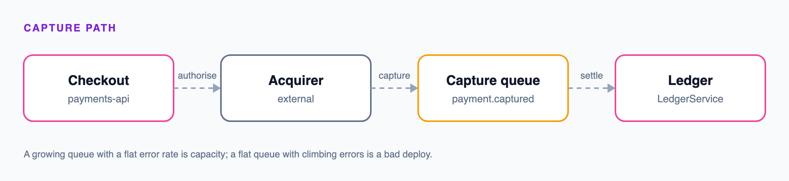

# Payments service runbook

Read the company [incident communications](/acme-handbook/incident-communications)
policy first if this is customer-visible.

## Symptom: capture failures climbing

1. Check the acquirer status page before anything else. Roughly half of these
   are not ours.
2. If the acquirer is healthy, look at the capture queue depth. A depth that is
   growing while error rate is flat means we are slow, not broken, and the fix
   is capacity rather than a rollback.
3. A flat queue with a climbing error rate is ours. Roll back the most recent
   deploy of `payments-api` and confirm the error rate falls within five
   minutes.

## What not to do

Do not replay captures during an incident. Replay is safe only once the
underlying failure is fixed, because a replay against a still-broken acquirer
burns the idempotency window. See the replay procedure for the ordering.

## Escalation

Page the payments on-call through the rota. If the acquirer is implicated, the
partnerships on-call has the direct line; do not email support.
