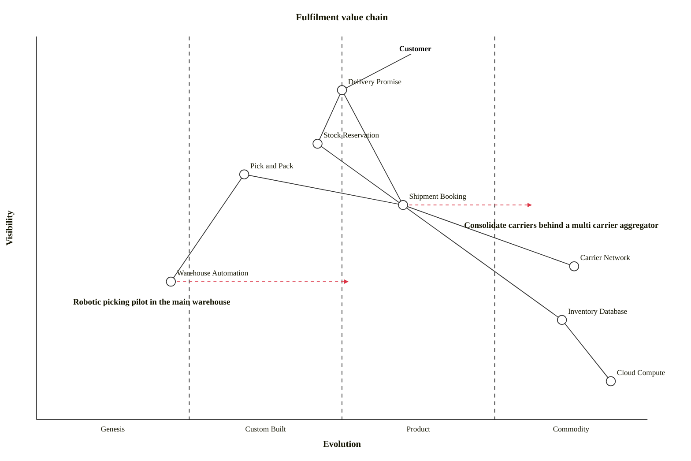

## Overview

The **Fulfilment** domain is responsible for the physical side of an order — making sure stock is available, picking and packing it, and shipping it to the customer. It owns three internal systems and integrates with external carriers:

### How the systems work together

When an order is completed, the **Warehouse System** picks and packs it, having relied on the **Inventory System** to reserve stock earlier in checkout. Once packed, the **Shipping System** creates a shipment with an external **Carrier**, which delivers it to the customer and reports progress back.

### Subdomains

The [[domain|returns]] subdomain handles the reverse journey — accepting return requests, approving them, and confirming when items arrive back so Payments can refund the customer and Inventory can restock.

## Value Chain

A Wardley map of the Fulfilment domain. Delivery is the promise customers see, carriers are a commodity we rent, and warehouse automation is the most novel part of the chain.

## System Diagram

The systems in this domain, how they relate, and the people who interact with them.
